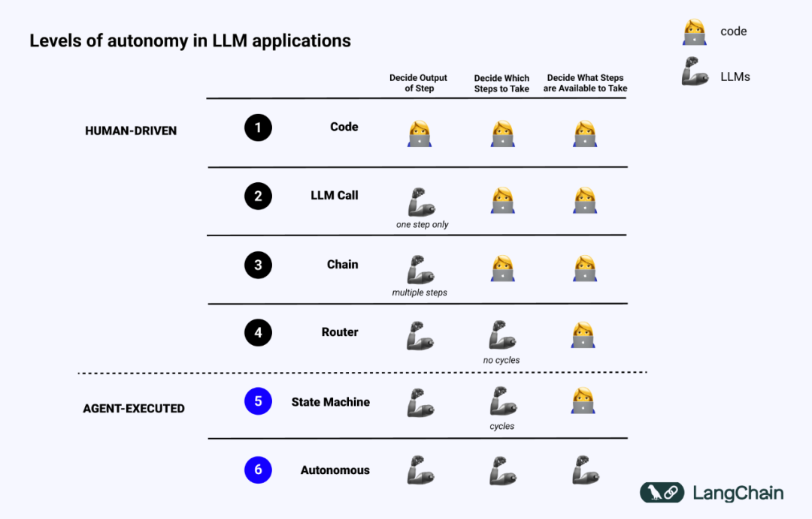
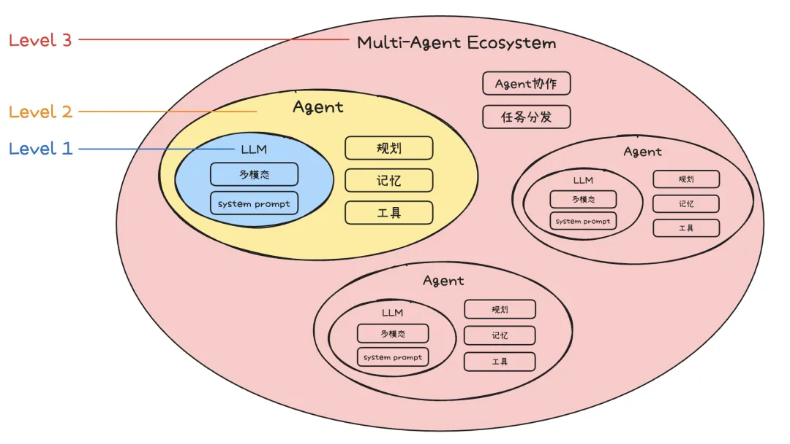
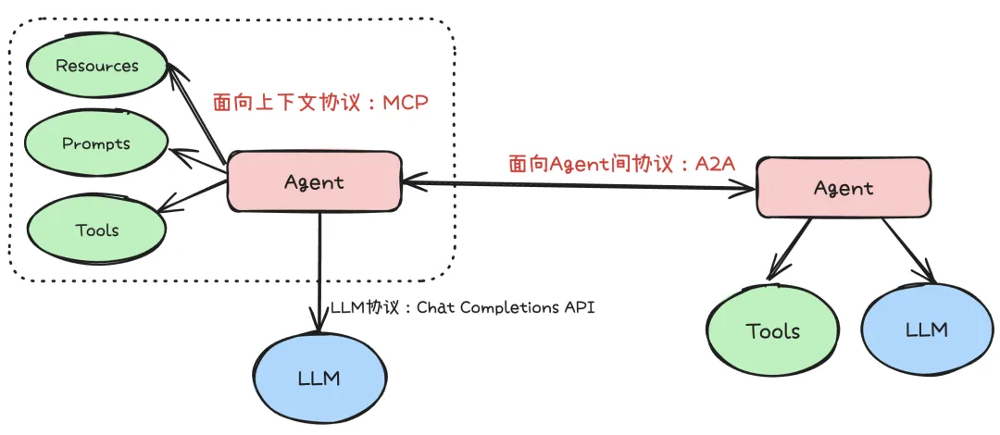
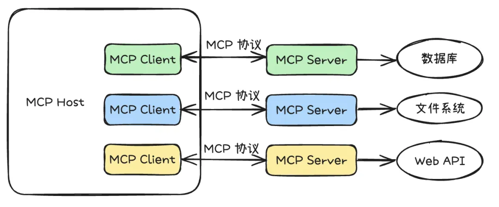
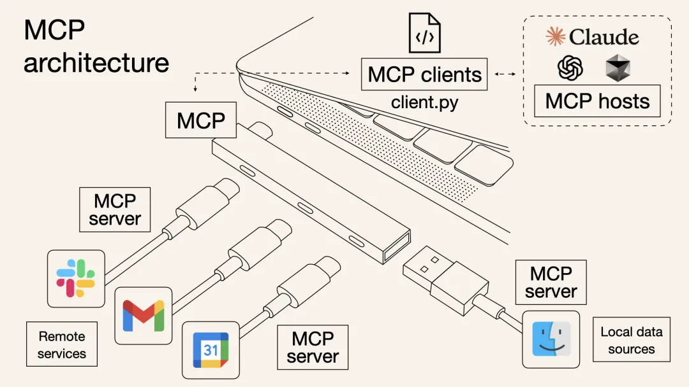
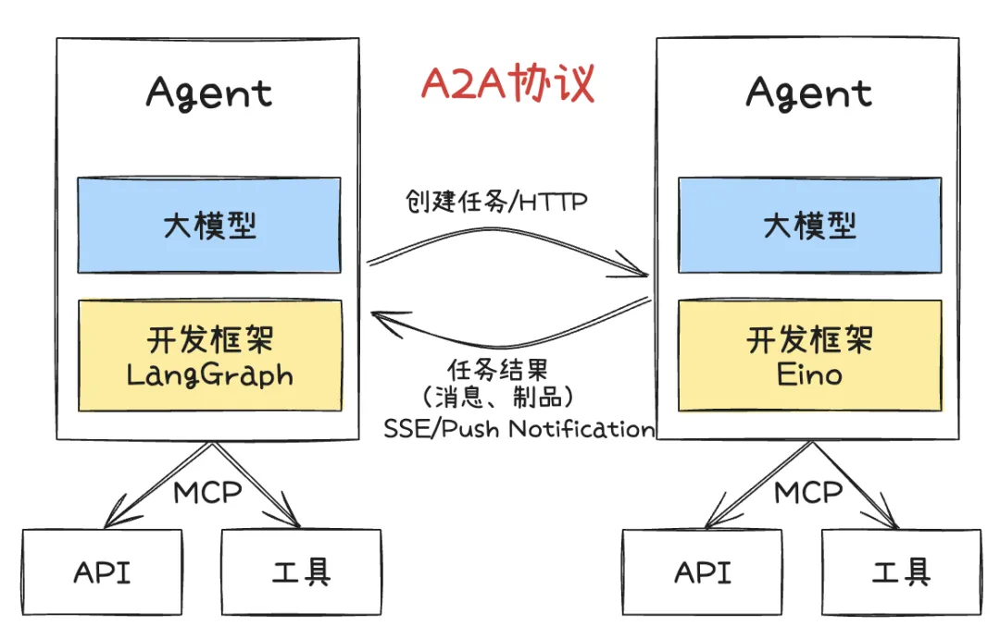

> 所属：[TinyAgent Docs](../README.md) › [参考资料](index.md)

# 智能体简介与开发范式

> 迁入自原根 README（2026-10 拆分）。

## 什么是智能体

智能体是一个使用大语言模型（LLM）来决定应用程序控制流的系统。

> Andrew Ng 在推文中建议「与其争论什么应被归类为真正的智能体，不如承认系统具有不同程度的智能体特性（agentic）」。
> 就像自动驾驶汽车有不同的自动化等级一样，我们也可以将智能体的能力视作一个光谱。

在人工智能领域，智能体被定义为任何能够通过 **传感器（Sensors）** 感知其所处 **环境（Environment）**，
并自主地通过 **执行器（Actuators）**采取 **行动（Action）** 以达成特定目标的实体。

### 智能体类型

1. 基于内部决策架构的分类
    - 简单的反应式智能体
    - 引入内部模型的模型式智能体
    - 基于目标和基于效用的智能体
2. 基于时间与反应性的分类：追求速度的反应性（Reactivity）与追求最优解的规划性（Deliberation）之间的平衡
    - 反应式智能体 (Reactive Agents)
    - 规划式智能体 (Deliberative Agents)
    - 混合式智能体 (Hybrid Agents)
3. 基于知识表示的分类
    - 符号主义 AI（Symbolic AI）
    - 亚符号主义 AI（Sub-symbolic AI）
    - 神经符号主义 AI（Neuro-Symbolic AI）

### 什么是智能体特性

### 智能体特性有什么用

了解系统的智能体特性能够指导你在开发过程中做出决策——包括构建、运行、与之交互、评估，甚至是监控。

## 如何为智能体进行规划

> 智能体的三大限制：规划、用户体验（UX）和记忆

### 什么是规划和推理

智能体的规划和推理涉及 LLM 决定采取哪些行动的能力。这个过程包括短期和长期的步骤。
LLM 需要评估所有可用的信息，然后决定：我需要采取哪些步骤？当前我应该采取的第一步是什么？

大多数情况下，开发者使用函数调用（也称为工具调用）来让 LLM 选择行动。

### 如何改善智能体的规划能力

可以选择两类认知架构来改善推理能力：通用认知架构和领域特定认知架构。

## AI Agent 开发范式

* Agent
    - LLM：多模态、System Prompt
    - 任务规划(Planning)
    - 记忆(Memory)
    - 工具选择(Tool)
* 多 Agent 协同(Multi-Agent Collaboration)
* 任务分发(Task distribution)

开发范式详解：

* **Level 1: LLM Agent**
    - 这个阶段 Agent 主要以聊天机器人的形态存在，但由于大模型存在幻觉，返回的信息不总是真实的，
      而且智能体的输出存在随机性、不可控的问题，直接通过 LLM + 提示词工程创建的 Agent，
      无法很好承载严肃场景的需求。
* **Level 2: AI Agent**
    - 除了 LLM 的参数规模，逻辑推理能力的不断提升外，还通过引入规划、记忆、工具使用这三个核心功能，
      实现了 AI Agent 对于更复杂任务的处理能力。也就是常说的：Agent = LLM + 记忆 + 规划技能 + 工具使用。
    - 规划：智能体能够根据给定目标，自主拆解任务步骤执行计划，例如 OpenManus，OWL 等通用智能体。
      针对特定领域的智能体，还可以通过预定义 Agent 的工作流，结合大模型的意图识别和流程控制，
      提升处理复杂任务过程中的稳定性，类似于 Dify、Coze、元器等平台。
    - 记忆：智能体具备长期记忆能力，能够存储和调用历史信息，在任务执行过程中保持上下文连贯性，
      更好地理解用户需求，并在多轮交互中提供更精准的反馈。
    - 工具使用：LLM 缺乏直接感知和影响现实世界的能力，工具是 LLM 连接外部世界的关键。
      近期爆火的 MCP 协议定义了工具的开发范式，通过标准化接口规范扩展智能体的能力边界。
* **Level 3: Multi Agent**
    - 不再依赖单一的"全能型" Agent，而是构建由多个专业化 Agent 组成的协作网络。
      每个 Agent 专注于特定领域或任务，通过任务分发、Agent 协同处理复杂的综合性任务。

## Agent 协议

* LLM 协议
    - Chat Completions API：OpenAI 提供的 Chat Completion API 定义了标准大模型请求的请求参数和响应格式，
      各大厂商通过适配协议参数的 HTTP 接口快速接入新的大模型。
* Context-Oriented（面向上下文）
    - MCP
* Inter-Agent（面向 Agent 间）
    - A2A（Agent2Agent）

### MCP

* [调用 Unity 的 MCP 接口，让 AI 自己开发游戏](https://www.bilibili.com/video/BV1kzoWYXECJ)
* [调用 Blender 的 MCP 接口，让 AI 自己 3D 建模](https://www.bilibili.com/video/BV1pHQNYREAX)
* [调用百度地图的 MCP 接口，让 AI 自己联网、查路况、导航](https://www.bilibili.com/video/BV1dbdxY5EUP)
* [调用 Playwright 的 MCP 接口，让 AI 自己操作网页](https://mp.weixin.qq.com/s/w_43x5fFVfDPDgMorn3XfA)

### Agent2Agent

## 相关

- [思考框架：CoT / ReAct / Plan-and-Execute](thinking-frameworks.md)
- [外部学习资料](learning-resources.md)
