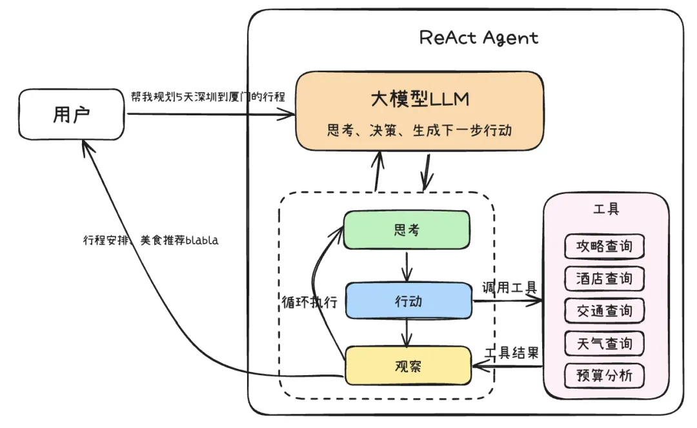
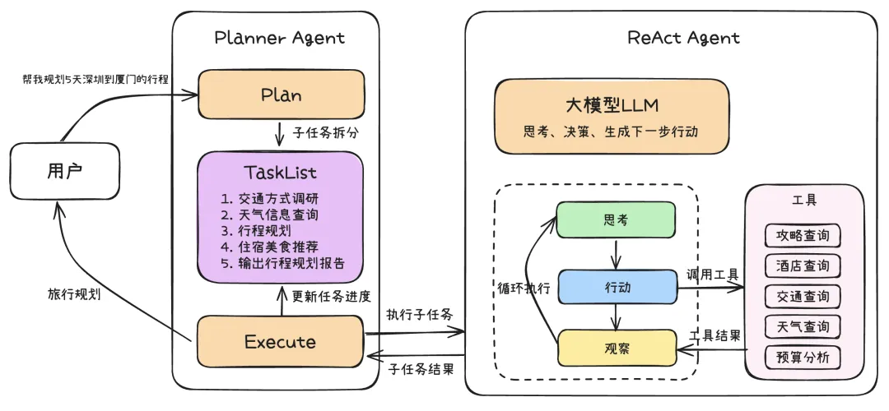

> 所属：[TinyAgent Docs](../README.md) › [参考资料](index.md)

# Agent 思考框架

> 迁入自原根 README（2026-10 拆分）。

构建能够自主规划、执行和适应复杂任务的智能体，其核心在于其"思考"能力。Agent 思考框架
正是为了赋予 Agent 这种结构化的推理和决策能力而设计的。这些框架提供了一套方法论，
指导 Agent 如何理解目标、分解任务、利用工具、处理信息、并根据环境反馈调整行为。

## 思维链-CoT

思维链（Chain of Thought, CoT）是一种增强大型语言模型（LLM）处理复杂推理任务能力的关键技术。
其核心在于引导模型在给出最终答案前，先生成一系列结构化的中间推理步骤——如同模拟人类解决问题时的逐步思考过程。
通过这种方式，LLM 能够更深刻地理解问题结构，有效分解复杂任务，并逐步推导出解决方案。
这些显式的思考步骤不仅带来了透明度和可解释性，也增加了计算成本和处理延迟。

随着 DeepSeek R1 的深度思考模式验证了思维链对于推理能力的显著提升效果，各大模型厂商纷纷推出了支持慢思考的模型，
例如腾讯的 Hunyuan T1、阿里千问的 QwQ。Anthropic 官方还开源了 Sequential Thinking MCP，
它通过精心设计的提示词工程，使得原本不支持慢思考的模型也能实现类似的推理过程，
目前已成为使用频率最高的 MCP Server（数据来源：<https://mcp.so/ranking>）。

## ReAct

CoT 虽然增强了模型的推理能力，但其推理过程主要局限于模型内部知识，缺乏与外部世界的实时交互，可能导致知识陈旧、产生幻觉或错误传播。
ReAct（Reasoning and Action）框架通过将"推理"（Reasoning）与"行动"（Action）相结合，有效地解决了这一问题。
其核心运作机制是 **思考（Thought）→ 行动（Action）→ 观察（Observation）** 的迭代循环：

* **思考 (Thought)**：模型基于当前任务目标和已有观察进行逻辑推理和规划，决定下一步动作（调用哪个工具、查询什么信息）。
* **行动 (Action)**：生成并执行具体的行动指令——调用外部 API、执行代码、查询数据库或与用户交互。
* **观察 (Observation)**：接收并处理行动执行后从外部环境获得的反馈，作为下一轮"思考"的输入，
  帮助模型评估进展、修正错误、迭代优化计划，直至任务完成。

## Plan-and-Execute

Plan-and-Execute 是对标准 ReAct 框架的扩展和优化，旨在处理更复杂、多步骤的任务。
它将 Agent 的工作流程明确划分为两个阶段：

* **规划阶段**：Agent 首先对复杂任务进行整体分析，生成高层次的计划，将原始任务分解为一系列更小、
  更易于管理的子任务。这种分解有助于在执行阶段减少处理每个子任务所需的上下文长度。
  这个蓝图可以先呈现给用户，允许用户在执行开始前对计划步骤给出修改意见。
* **执行阶段**：按规划逐步执行每个子任务，执行时可采用标准 ReAct 循环处理细节。
  执行过程中监控每个子任务的完成情况：成功则继续下一个；遇到失败或预期之外的情况，
  则重新评估当前计划，动态调整或返回规划阶段修正。此阶段同样可引入用户反馈。

## 相关

- [智能体简介与开发范式](agent-intro.md)
- L1 三范式实现见 [基础与手写](../10-scratch/index.md)
